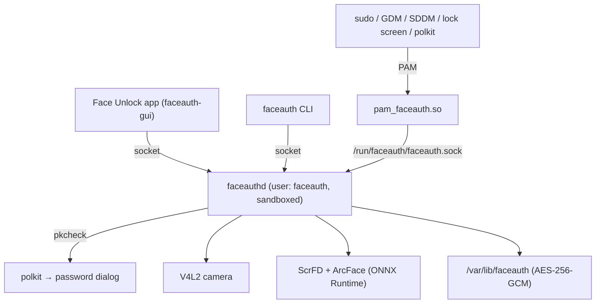

# FaceAuth architecture

This is an overview. The authoritative description of every flow, message and
trust boundary is [docs/DESIGN.md](docs/DESIGN.md). Algorithms are covered in
[TECHNICAL_DETAILS.md](TECHNICAL_DETAILS.md).

## Components



| Component | Role |
|---|---|
| `pam_faceauth` | A small PAM module (`cdylib`). It asks the daemon whether the user is in front of the camera, shows short messages through the PAM conversation, and maps the outcome to a PAM result. It processes no images. It only trusts a daemon running as root or `faceauth`, and skips remote sessions. |
| `faceauthd` | The only component that touches the camera, the models and the face data. It runs as the unprivileged `faceauth` system user in a strict systemd sandbox (`dist/faceauth.service`). Every caller is identified by `SO_PEERCRED`; enrollment changes are authorized through polkit. |
| `faceauth-gui` | The **Face Unlock** app (GTK 4 + libadwaita). It shows status, runs enrollment and tests. It displays the preview the daemon streams and never opens the camera itself. |
| `faceauth` (CLI) | Status, enrollment in the terminal, test, remove, list, cameras, doctor, benchmark. |
| `faceauth-core` | The wire protocol (requests, responses, enrollment events) and framing shared by all of the above. |

## Repository layout

```text
faceauth/
├── Cargo.toml              # Workspace (shared version)
├── install.sh              # Installer (curl | bash, or from a checkout)
├── uninstall.sh            # Uninstaller (also installed to /usr/local/share/faceauth/)
├── dist/
│   ├── faceauth.service    # Sandboxed systemd unit (User=faceauth)
│   ├── org.faceauth.manage.policy  # Polkit action for enrollment changes
│   └── config.toml         # Default /etc/faceauth/config.toml
├── docs/DESIGN.md          # Flows, protocol, trust boundaries
├── assets/                 # App icon and .desktop file
├── faceauth-core/src/lib.rs        # Protocol types, framing, username validation
├── faceauthd/src/          # Daemon: server, authorization, polkit, camera,
│                           # detection, recognition, enrollment, storage, config
├── pam_faceauth/src/lib.rs # PAM entry points
├── faceauth-cli/src/main.rs
├── faceauth-gui/src/       # Face Unlock app
└── models/                 # ONNX models for development (not in git)
```

## Installed layout

| Path | Owner / mode | Purpose |
|---|---|---|
| `/usr/local/bin/faceauthd`, `faceauth`, `faceauth-gui` | root 0755 | Programs |
| `<pam dir>/pam_faceauth.so` | root 0644 | PAM module (next to `pam_unix.so`) |
| `/etc/systemd/system/faceauth.service` | root 0644 | Service unit |
| `/usr/share/polkit-1/actions/org.faceauth.manage.policy` | root 0644 | Polkit action |
| `/etc/faceauth/config.toml` | root 0644 | Configuration |
| `/etc/faceauth/pam-services` | root 0644 | PAM files the installer changed |
| `/usr/share/faceauth/models/` | root 0644 | ScrFD and ArcFace models |
| `/var/lib/faceauth/` | faceauth 0700 | `master.key` and `<user>/models.enc` |
| `/run/faceauth/faceauth.sock` | faceauth (dir 0755, socket 0666) | IPC |

## Authentication at a glance

1. `sudo` calls `pam_sm_authenticate`. The module skips remote sessions,
   connects to the socket and checks the peer is root or `faceauth`.
2. It sends `Authenticate { user }`. Before touching the camera, the daemon
   checks:
   - the caller may act for that user;
   - the user is enrolled with the current model;
   - the user isn't locked out;
   - no enrollment change for the user is being authorized;
   - the camera is free.
3. The daemon replies `Scanning` (the module shows "look at the camera…"). It
   then captures frames, detects the largest face, aligns and embeds each
   frame, and takes a majority vote.
4. It replies `Auth(outcome)`. `Matched` becomes `PAM_SUCCESS`; anything else
   falls through to the password.

## Enrollment at a glance

1. The app sends `Enroll { mode }`. The daemon resolves the user from the
   peer's uid and asks polkit, with the client's pid, start time and uid. The
   user's password dialog appears.
2. The daemon opens the camera and streams `Frame` (mirrored JPEG preview plus
   face box) and `Progress` (samples, wanted pose, hint) events.
3. Each sample must pass the quality, pose, same-person and duplicate checks.
4. Nothing is written until all samples are collected. The profile is then
   replaced or appended to atomically, and `Completed` is sent. Closing the
   connection cancels at any point.

## Security architecture

- **Least privilege.** The daemon has no capabilities, sees a read-only system
  and no home directories, has no network, and can only open video devices. A
  bug in image or model parsing is contained to `/var/lib/faceauth` and
  `/run/faceauth`.
- **Kernel-verified identity.** `SO_PEERCRED` on both sides of the socket:
  - the daemon authorizes callers by uid;
  - the PAM module authenticates the daemon by uid.
- **Password-gated changes.** Polkit `auth_self` gates every enrollment change.
  Face authentication for that user is refused while the check runs.
- **Fail closed.** A missing model, invalid config, corrupt key or degenerate
  embedding stops the operation. Errors in PAM fall through to the password.
- **No photos at rest.** Only embeddings are stored, with AES-256-GCM. Each
  profile records the recognition model's ID so a model change can't silently
  break or weaken matching.
- **Honest liveness.** The frame-difference check rejects static images only.
  RGB spoofing is a documented limitation (see README).
- **Rate limiting.** After `max_attempts` not-recognized attempts, face unlock
  pauses for `lockout_seconds`. Bad lighting and empty frames don't count.
- **Audit log.** Every attempt, enrollment, removal and denied request is
  logged to the journal (`journalctl -u faceauth.service`).
