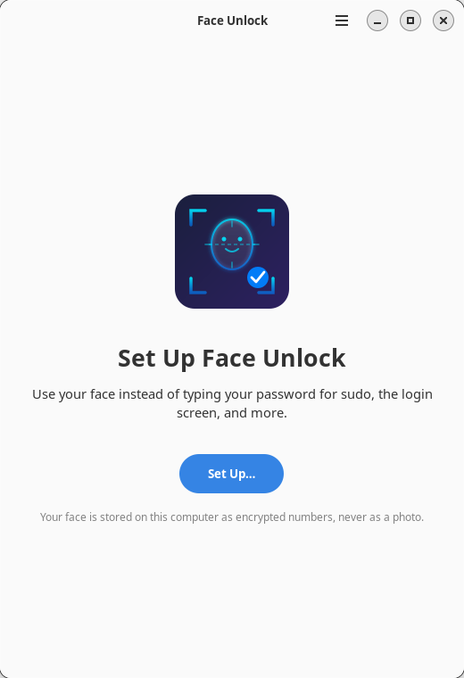
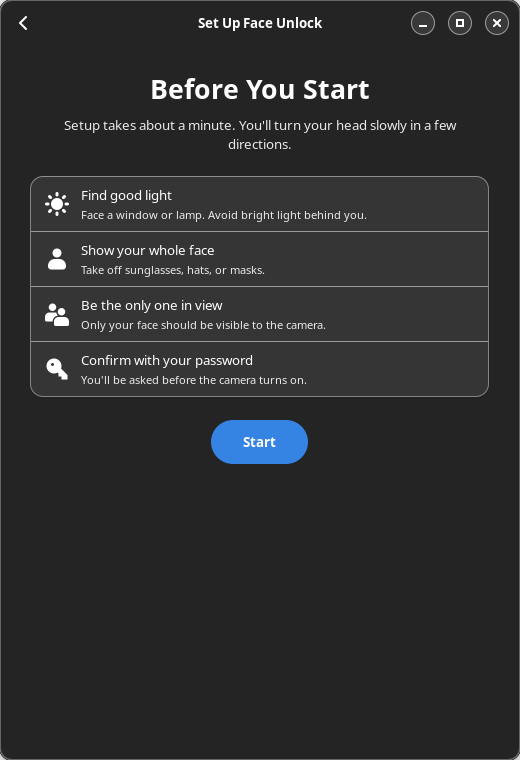
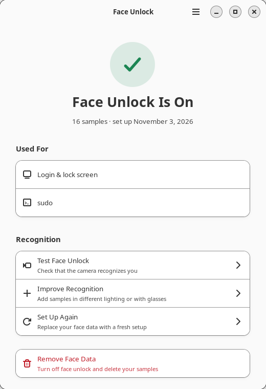
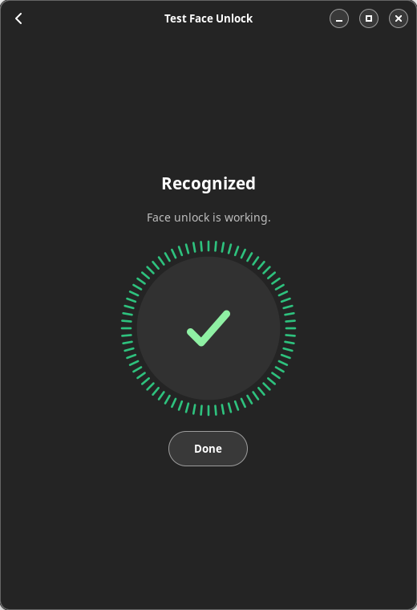

<h1 align="center">FaceAuth</h1>

<p align="center">
  <strong>Face unlock for Linux</strong><br>
  Use your face for <code>sudo</code>, your login screen, your lock screen and admin prompts.
  Your password keeps working everywhere.
</p>

<p align="center">
  <a href="#install">Install</a> •
  <a href="#getting-started">Getting started</a> •
  <a href="#security-model--limitations">Security model</a> •
  <a href="#troubleshooting">Troubleshooting</a> •
  <a href="docs/DESIGN.md">Design</a>
</p>

<p align="center">
  
  
  
  
</p>

---

## Requirements

| Part | Needs |
|---|---|
| Daemon, PAM module, `faceauth` CLI | Any Linux distribution with systemd and PAM, a V4L2 camera, a recent stable Rust toolchain to build (the installer sets one up if missing) |
| **Face Unlock** app | GTK 4.12+ and libadwaita 1.4+: Ubuntu 24.04+, Fedora 39+, Debian 13+, Arch Linux, openSUSE Tumbleweed |

On older systems (for example Ubuntu 22.04 or Debian 12) the installer skips
the app, and you set up face unlock in the terminal with `faceauth enroll`.

## Install

```bash
curl -fsSL https://raw.githubusercontent.com/ibrahimgulbutt/faceauth/main/install.sh | bash
```

Prefer to read it first?

```bash
curl -fsSLO https://raw.githubusercontent.com/ibrahimgulbutt/faceauth/main/install.sh
less install.sh
bash install.sh
```

Or install from a checkout. This builds exactly the code you have:

```bash
git clone https://github.com/ibrahimgulbutt/faceauth.git
cd faceauth
./install.sh
```

The installer:

1. installs build dependencies and Rust if needed, then builds from source
   (a few minutes the first time);
2. creates the unprivileged `faceauth` system user and installs the daemon, PAM
   module, polkit policy and app;
3. downloads the face models from InsightFace's official releases and verifies their SHA-256 checksums;
4. starts the service;
5. uses the infrared camera if there is one: checks that its light works,
   switches it on for you if it doesn't, and falls back to the colour camera
   if that fails (see [Infrared cameras](#infrared-cameras));
6. asks where to use face unlock.

That one command is all you need; nothing has to be downloaded or set up
separately.

**Running it again** is safe. It tells you what it will do first: install,
upgrade ("FaceAuth 1.0.0 is installed. Upgrading to 1.1.0"), or, on the same
version, repair. Your settings and face data are
kept, and your current choices are the defaults.

Non-interactive options: `--pam=sudo,login,lock,polkit`, `--model=accurate|fast`,
`--camera=auto|ir`, `--yes`, `--no-gui` (see `./install.sh --help`).

## Getting started

1. Open **Face Unlock** from your app menu and choose **Set Up**
   (or run `faceauth enroll` in a terminal).
2. Confirm with your password. Changing face data always needs it.
3. Follow the prompts: look straight, then turn your head left and right, and
   tilt your chin up and down. It takes about 30 seconds.
4. Try it:

   ```bash
   sudo echo "Hello from FaceAuth"
   ```

You'll see `FaceAuth: look at the camera…`. If your face isn't recognized,
you're asked for your password as usual.

Wearing glasses sometimes, or working in different lighting? Use
**Improve Recognition** in the app (or `faceauth enroll --add`) to add samples.

## Where it works

| Choice in the installer | PAM services | Notes |
|---|---|---|
| sudo | `sudo` | Recommended starting point |
| Login screen | `gdm-password`, `sddm`, `lightdm` | GNOME's lock screen also uses `gdm-password` |
| Lock screen | `kde`, `swaylock`, `hyprlock`, `i3lock`, … | Whichever exist on your system |
| Admin prompts | `polkit-1` | Password dialogs from apps and system settings |

To change this later, run the installer again with, for example,
`./install.sh --pam=sudo,login`. Face unlock is never used for remote (SSH)
sessions.

## Features

- **Quick:** about a second from `sudo` to unlocked on a typical laptop.
- **Guided setup:** a live, face-centred preview with clear prompts. Each pose
  is checked against facial landmarks, and samples are rejected if the face is
  too far away, badly lit, a different person, or more than one person.
- **Password fallback, always:** any failure, missing camera or stopped service
  simply falls through to your password.
- **No photos stored:** only 512-number face embeddings, encrypted with
  AES-256-GCM.
- **Locked-down daemon:** runs as an unprivileged user in a strict systemd
  sandbox. Callers are identified by the kernel, so nobody can act on another
  user's face data.
- **Any V4L2 camera,** including infrared (Windows Hello-style) cameras, which
  work in the dark. Dim colour images are brightened before recognition.
- **Rate limiting and audit logging** of every attempt to the system journal.

## How it works

```
sudo ──▶ pam_faceauth.so ──▶ faceauthd (user "faceauth")
                                 │ camera: warm-up, then 5 frames
                                 │ ScrFD: find the largest face, 5 landmarks
                                 │ align to 112×112, ArcFace: 512-d embedding per frame
                                 │ cosine similarity vs. your samples, majority vote
                                 ▼
             Matched ──▶ unlocked     anything else ──▶ password prompt
```

| Component | Implementation |
|---|---|
| Detection | SCRFD-500MF |
| Recognition | ResNet50 (*accurate*, default) or MobileFaceNet (*fast*), both trained with ArcFace loss on WebFace600K |
| Runtime | ONNX Runtime |
| Language | Rust |
| IPC | Unix socket `/run/faceauth/faceauth.sock`, callers identified with `SO_PEERCRED` |

More detail: [docs/DESIGN.md](docs/DESIGN.md) (flows and trust boundaries),
[ARCHITECTURE.md](ARCHITECTURE.md), [TECHNICAL_DETAILS.md](TECHNICAL_DETAILS.md).

### Face models

FaceAuth uses InsightFace's models, downloaded by the installer straight from
[InsightFace's releases](https://github.com/deepinsight/insightface/releases/tag/v0.7)
and checked against pinned SHA-256 checksums ([dist/fetch-models.sh](dist/fetch-models.sh)).
You choose the recognizer when installing:

| Recognizer | Download | Hard mixed test (MR-ALL) | East Asian | IJB-C | LFW | Per frame (i5-1145G7) |
|---|---|---|---|---|---|---|
| **Accurate** — ResNet50 (`buffalo_l`), default | ~290 MB | **91.25** | **74.96** | 97.25 | 99.83 | ~155 ms (4 threads) |
| **Fast** — MobileFaceNet (`buffalo_sc`) | ~15 MB | 71.87 | 51.03 | 95.02 | 99.70 | ~45 ms (1 thread) |

Accuracy figures are InsightFace's published numbers; timings are from
`faceauth benchmark` on this project's development laptop. The two score alike
on easy, front-facing photos (LFW), but on the hard test, which shows how well
a model keeps look-alikes apart at strict settings, the accurate model is far
better, and much more even across ethnicities. It adds roughly 0.2–0.3 s to a
successful login. Both use the same SCRFD-500MF face detector.

To switch, re-run the installer with `--model=fast` or `--model=accurate`.
Everyone then has to set up face unlock again, because embeddings from
different models can't be compared.

## Performance

**Measured with `faceauth benchmark` (release build) on an 11th Gen Intel Core i5-1145G7 laptop with its built-in 720p webcam:**

| Stage | Accurate (default) | Fast |
|-------|------|------|
| Camera open, warm-up and 5-frame capture | 0.8–1.3 s warm, up to ~2.2 s cold | same |
| Face detection (runs while the frames are captured) | ~180 ms | ~180 ms |
| Recognition per frame (frame 1 runs during capture) | ~155 ms | ~45 ms |
| **Typical successful login** (vote decided after 3 frames) | **camera + ~0.3 s** | **camera + ~0.1 s** |

Most of the time is the camera itself: opening the device and letting
auto-exposure settle, which is slower in dim light.

| System | Time | Hardware required |
|--------|------|------------------|
| **FaceAuth** | **~1.1–1.6 s** (warm camera) | Any webcam (IR optional) |
| Windows Hello | 0.4–0.6 s | IR camera required |
| Howdy | 2.0–3.5 s | Any webcam |

Run `faceauth benchmark` to measure your own machine.

## Commands

| Command | What it does |
|---|---|
| `faceauth` | Show whether face unlock is set up for you |
| `faceauth enroll` | Set up face unlock (replaces existing samples) |
| `faceauth enroll --add` | Add samples to improve recognition |
| `faceauth test` | Check that your face is recognized |
| `faceauth remove` | Delete your face data (asks first; `--yes` to skip) |
| `faceauth list` | List enrolled users (all users when run as root) |
| `faceauth cameras` | List cameras and show which one is used |
| `faceauth doctor` | Check the service, camera, models, config and PAM setup |
| `faceauth benchmark` | Time the capture, detection and recognition steps, and show face brightness |
| `faceauth ir-emitter` | Show the IR-light settings saved by linux-enable-ir-emitter |
| `faceauth version` | Show the CLI and daemon versions |

As root, `enroll`, `test` and `remove` accept `--user NAME`.

## Configuration

`/etc/faceauth/config.toml`. Every key is optional:

```toml
[camera]
device = "auto"              # or "/dev/video2", "/dev/v4l/by-id/..."
warmup_frames = 8            # frames discarded after a cold start
sequence_length = 5          # frames per attempt; a majority must match
sequence_interval_ms = 40

[detection]
confidence_threshold = 0.5   # 0–1, minimum detector confidence
min_face_size = 80           # pixels; smaller faces are too far away

[recognition]
match_threshold = 0.55       # 0–1, higher is stricter; below 0.45 lets others in more easily

[security]
require_liveness = true      # rejects completely static images only
max_attempts = 3             # not-recognized attempts before a pause
lockout_seconds = 60
```

Apply changes with `sudo systemctl restart faceauth.service`, then check them
with `faceauth doctor`.

### Infrared cameras

Many laptops (those with Windows Hello) have an infrared camera next to the
normal one. It works in complete darkness and is much harder to fool with a
photo, because it lights your face with its own invisible infrared light (the
emitter).

**Using it.** The installer picks it automatically when it finds one
(`--camera=auto` keeps the colour camera), or set it yourself:

```toml
[camera]
device = "ir"
```

Then `sudo systemctl restart faceauth` and set up face unlock again (faces
look different in infrared, so colour face data doesn't carry over).
`faceauth cameras` lists your cameras and marks the IR ones.

**The emitter.** On Windows a vendor driver switches the emitter on. Linux's
generic camera driver doesn't know that vendor command, so on many laptops the
emitter stays off and the IR picture is nearly black. To check, run
`faceauth benchmark` while looking at the camera: a face brightness below about
40 means the emitter is off. You can also look at the camera through a phone
camera while it runs: phone cameras show the emitter as a flickering purple
light.

**The installer handles this.** It looks through the IR camera, and if the
light is off it switches it on: it downloads [linux-enable-ir-emitter](https://github.com/EmixamPP/linux-enable-ir-emitter)
(MIT licensed, checksum-verified), runs it with short on-screen instructions,
saves what it finds and checks again. If the light can't be switched on, it
goes back to the colour camera so face unlock still works.

Doing it by hand instead: linux-enable-ir-emitter
can find the vendor command for your camera. It's used by many people for
exactly this, works with most UVC infrared cameras, and asks you to confirm
before saving anything (a wrong value can make the camera misbehave until a
reboot, which is why FaceAuth doesn't guess commands itself):

1. Install it from its releases page (one `sudo tar` command, see its README).
2. Run it **as yourself, not with sudo**, sitting close to the camera:
   `linux-enable-ir-emitter configure`. Choose the IR camera and answer its
   questions.
3. Re-run the FaceAuth installer and choose the infrared camera. It reads what
   the tool saved (`~/.config/linux-enable-ir-emitter.toml`) and FaceAuth then
   switches the light on itself every time it uses the camera. You don't need
   to run the tool again.
4. Check with `faceauth benchmark`, then set up face unlock again.

`faceauth ir-emitter` shows what the tool saved and the lines FaceAuth uses.
`faceauth doctor` shows whether FaceAuth is switching the light on. The
commands are only ever sent to the infrared camera.

Emitters that flash on every other frame are handled automatically.

## Troubleshooting

| Problem | What to do |
|---|---|
| **"FaceAuth service isn't running"** in the app, or `faceauth ping` fails | `sudo systemctl status faceauth.service` and `sudo journalctl -u faceauth.service -n 50`. Usually the models are missing in `/usr/share/faceauth/models/`; run `faceauth doctor`. |
| **Camera unavailable or busy** | Another app (a video call, a browser tab) may be using it. Close it and try again. Check `faceauth cameras` and `camera.device`. |
| **"Needs to be set up again"** | The recognition model or the camera (colour vs infrared) changed, or the face data is from before 1.0. Open the app and choose **Set Up Again**, or run `faceauth enroll`. |
| **No password dialog appears when setting up** | Your desktop has no polkit authentication agent running (common on minimal window managers). Start one (for example `polkit-gnome` or `hyprpolkitagent`), run `faceauth enroll` in a terminal, or run `sudo faceauth enroll --user $USER`. |
| **Not recognized in a dark room** | Dim light is handled (dark images are brightened), but a colour camera can't see in real darkness. Use the IR camera if you have one (see [Infrared cameras](#infrared-cameras)), or face a light. Bad lighting doesn't count toward the lockout. |
| **"The infrared light seems to be off"** | The IR camera's emitter isn't on. See [Infrared cameras](#infrared-cameras). |
| **Recognized less often than you'd like** | Use **Improve Recognition** in the lighting where it fails. Lowering `match_threshold` also helps, but makes it easier for others to pass. |
| **Something else** | Run `faceauth doctor` and [open an issue](https://github.com/ibrahimgulbutt/faceauth/issues) with its output, your distribution, camera model and the daemon log. |

## Security model & limitations

FaceAuth is a **convenience** unlock, like a fingerprint reader. It is not
stronger than your password, and the password always remains a valid way in.
What it guarantees:

- **Changing face data needs your password.** Setting up, adding samples and
  removing face data are confirmed through polkit with your own password. Face
  unlock is never accepted for that confirmation.
- **Each user controls only their own face data.** The daemon identifies every
  caller through the kernel (`SO_PEERCRED`). Users can only set up, test or
  remove their own face; only root can act for others.
- **PAM only trusts the real daemon.** The PAM module only accepts answers from
  a daemon running as root or the `faceauth` user, through a socket in
  `/run/faceauth/` that nobody else can create.
- **The daemon is contained.** It runs as the unprivileged `faceauth` user in a
  strict systemd sandbox: no capabilities, read-only system, no home
  directories, no network, video devices only.
- **Scores are never shown to non-root users.** That stops anyone from using
  `faceauth test` to tune a spoof.

What you should know before enabling it:

- **Ordinary RGB webcams can be fooled.** A good enough photo or video of you
  held up to the camera may unlock your account. The liveness check only
  rejects completely static images. An IR camera helps (screens look black in
  infrared), but FaceAuth has no dedicated anti-spoofing model.
- **Remote sessions are skipped on a best-effort basis.** Detection uses
  `PAM_RHOST` and SSH environment variables, the same approach as Howdy. A
  remote user who deliberately clears those variables can still trigger the
  camera.
- **Face login does not unlock your keyring.** GNOME Keyring and KWallet need
  your password, so you may be asked for it after a face login.
- **Face embeddings are biometric data.** They are stored encrypted in
  `/var/lib/faceauth/`, readable only by the `faceauth` user. The key sits on
  the same disk, so the encryption protects a copied profile file, not a
  compromised root account or an unencrypted stolen disk. Remove your data with
  **Remove Face Data** in the app or `faceauth remove`.

Use a strong password, and don't rely on face authentication alone for
high-value machines. See [SECURITY.md](SECURITY.md) to report a vulnerability.

## Uninstall

```bash
/usr/local/share/faceauth/uninstall.sh          # or ./uninstall.sh from a checkout
```

It removes face unlock from every PAM file, restoring exactly what the
installer changed, along with every installed file. It asks before deleting your
face data and configuration. `--purge` deletes them without asking.

## License

The FaceAuth source code is MIT licensed — see [LICENSE](LICENSE).

**The face models are not.** The SCRFD, ResNet50 and MobileFaceNet models come from
[InsightFace](https://github.com/deepinsight/insightface/tree/master/model_zoo),
whose pretrained models are available *for non-commercial research purposes
only*. FaceAuth doesn't redistribute them: the installer downloads them from
InsightFace's own releases. The MIT license does not cover them, and you are
responsible for complying with InsightFace's terms.

## Contributing

Contributions are welcome. See [CONTRIBUTING.md](CONTRIBUTING.md) for the
development setup (you can run the whole stack without root), and
[docs/DESIGN.md](docs/DESIGN.md) for how the pieces fit together. Please
report security issues privately as described in [SECURITY.md](SECURITY.md).

## Acknowledgments

- [SCRFD](https://github.com/deepinsight/insightface/tree/master/detection/scrfd): face detection model
- [ArcFace](https://github.com/deepinsight/insightface/tree/master/recognition/arcface_torch): face recognition model
- [Howdy](https://github.com/boltgolt/howdy), the project that pioneered face login on Linux
- [linux-enable-ir-emitter](https://github.com/EmixamPP/linux-enable-ir-emitter): IR emitter support
