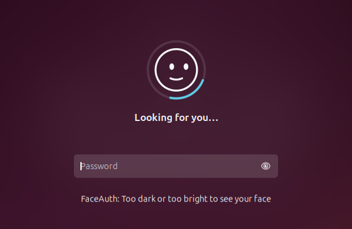

# Installing FaceAuth, step by step

This guide walks through the whole setup with pictures: installing, switching
on an infrared camera's light, setting up your face and trying it. It takes
about 10 minutes. Your password always keeps working, whatever happens.

**Contents**

1. [Run the installer](#1-run-the-installer)
2. [Answer its questions](#2-answer-its-questions)
3. [Switch on the infrared light](#3-switch-on-the-infrared-light-infrared-cameras-only) (infrared cameras only)
4. [Set up your face](#4-set-up-your-face)
5. [Try it](#5-try-it)
6. [Running the installer again](#6-running-the-installer-again)
7. [If something goes wrong](#7-if-something-goes-wrong)
8. [Uninstall](#8-uninstall)

---

## 1. Run the installer

Open a terminal **as your normal user** (not `sudo -i` or a root shell) and run:

```bash
curl -fsSL https://raw.githubusercontent.com/ibrahimgulbutt/faceauth/main/install.sh | bash
```

Or, from a copy of the code:

```bash
git clone https://github.com/ibrahimgulbutt/faceauth.git
cd faceauth
./install.sh
```

That's the only command you need. The installer downloads everything itself
(build tools and the face models) and
checks every download against a known checksum. Building takes a few minutes
the first time.

It asks for your password once, so it can install system files.

---

## 2. Answer its questions

Press **Enter** to accept the suggested answer, shown in `[brackets]`.

**Face recognizer**

```
Which face recognizer should FaceAuth use?
  1) Accurate  ResNet50, much better at telling similar faces apart (~300 MB download) [recommended]
  2) Fast      MobileFaceNet, smaller and quicker (~15 MB download)
Choose [1]:
```

Press **Enter** for Accurate.

**Camera** (only on computers with an infrared camera, such as laptops made
for Windows Hello)

```
This computer has an infrared camera (Integrated IR Camera). Which camera should FaceAuth use?
  1) Infrared camera  works in the dark, harder to fool [recommended]
     (if its light is off, the installer tries to switch it on by itself)
  2) Normal camera    works right away, needs some light
Choose [1]:
```

Press **Enter** for the infrared camera. If you'd rather skip the light setup
in step 3, choose **2**. You can switch later by running the installer again.

**Where to use face unlock**

The installer lists the places it can add face unlock: `sudo`, the login
screen, the lock screen, and admin password prompts. Choose the ones you want.
`sudo` alone is a good start.

---

## 3. Switch on the infrared light (infrared cameras only)

An infrared camera sees with its own invisible infrared light, the
**emitter**, next to the lens. On Windows a vendor driver switches it on. Linux
doesn't know that vendor command, so on many laptops the light stays off and
the infrared picture is almost black, **even in a bright room**: normal room
lights give off almost no infrared.

Many IR cameras switch their light on by themselves; it only lights what's
close, so the room looks dark but your face is visible. The installer checks
whether the IR camera can find your face, and if it can, you're done:

```
==> Setting up the infrared camera
    Look at the camera, then press Enter:
    ✓ The infrared camera can see you (face brightness 22; dim is normal for infrared)
```

If it can't see you, the installer tries to switch the light on by itself.
You only have to keep looking at the camera:

```
==> Setting up the infrared camera
    Look at the camera, then press Enter:
    Switching on the infrared light automatically. Sit in front of the camera, fairly
    close, and keep still while FaceAuth tries the camera's settings (a few minutes).
  154 settings to try (face brightness now 24 of 255)
  Tried 60 of 154…
✓ Found it: brightness 24 → 140.
    ✓ The infrared camera can see you now (face brightness 140)
```

FaceAuth tries the camera's hidden settings one at a time. After each, it
checks whether your face suddenly becomes clearly brighter, and it confirms
by switching the setting off and on again. Every setting is put back
straight after it's tried. Once found, FaceAuth switches the light on itself
whenever it uses the camera.

**If no setting switches the light on,** some laptops need more than one
vendor command, which nobody has worked out for every model. The installer
then uses your normal camera instead, so face unlock still works (it just
needs some light):

```
! No setting switched the infrared light on.
    This camera's infrared light couldn't be switched on, so it can't see in the dark.
    ✓ Using the normal camera instead
```

The next time you run the installer, the normal camera is the suggested
answer.

---

## 4. Set up your face

Open **Face Unlock** from your app menu (or run `faceauth enroll` in a
terminal).


Choose **Set Up**. It asks for your password, so nobody else can add their
face to your account.


Then follow the prompts: look straight at the camera, then slowly turn your
head left, right, up and down. The ring fills as good pictures are collected.
Only your face should be in view.


**Already set up before, or changed camera?** Face data from another camera
or an older version can't be reused. The installer notices and offers to set
up your face again right away. If you skip that, the app says face unlock is
**paused**; choose **Set Up Again**.

---

## 5. Try it


**On GNOME** (Ubuntu's normal desktop), **log out and back in once** after
installing. From then on a small face shows while FaceAuth checks you. It
looks for you, smiles when it recognizes you, and looks sad when it doesn't:

| Lock screen | `sudo` and admin prompts |
|---|---|
|  |  |

(These pictures come from a plain test setup. You'll see your own wallpaper.)

Use **Test** in the app, or in a terminal:

```bash
sudo -k && sudo echo "Hello from FaceAuth"
```

You'll see `FaceAuth: look at the camera…` and, about a second later, the
command runs without asking for your password. If you're not recognized, it
simply asks for your password as usual.

---

## 6. Running the installer again

Running the installer again is safe, and it says what it's going to do first:

| You have | It says |
|---|---|
| Nothing installed | `Installing FaceAuth 1.0.0` |
| The same version | `FaceAuth 1.0.0 is already installed. Reinstalling it to repair anything missing.` |
| An older version | `FaceAuth 1.0.0 is installed. Upgrading to 1.1.0` |
| A newer version | asks before installing the older one |

Your settings and face data are kept, and your current choices are offered
as the defaults. Run it again to repair a broken install, upgrade, switch
camera, or retry the infrared light.

---

## 7. If something goes wrong

Start with:

```bash
faceauth doctor
```

It checks the service, camera, models, infrared light, PAM and polkit, and
tells you what to fix.

| Problem | What to do |
|---|---|
| `sudo: ./install.sh: command not found` | You're not in the FaceAuth folder. `cd` into it first. |
| `Run this as your regular user, not root` | You're in a root shell (`root@…#`). Type `exit`, then run the installer again. |
| The infrared picture is black in a bright room | Normal: room lights give off almost no infrared. The camera's own light has to be on; see [step 3](#3-switch-on-the-infrared-light-infrared-cameras-only). |
| Not sure the infrared light works | `faceauth benchmark` while looking at the camera. If it shows a face brightness, the light works (dim is normal for infrared). If it says "none in view" while you're looking at it, the light is off. |
| The app says face unlock is **paused** | The camera or face model changed. Choose **Set Up Again**. |
| No password dialog when setting up | Run `faceauth enroll` in a terminal instead. |
| Not recognized in the dark with the normal camera | A normal camera can't see in the dark. Use the infrared camera. |

Still stuck? [Open an issue](https://github.com/ibrahimgulbutt/faceauth/issues)
with the output of `faceauth doctor`.

---

## 8. Uninstall

```bash
/usr/local/share/faceauth/uninstall.sh
```

It removes FaceAuth from every PAM file (with backups), the service, the files
and, if you agree, your face data. Earlier versions of the installer could
also install `linux-enable-ir-emitter` in `/usr/local/bin`; remove it with
`sudo rm /usr/local/bin/linux-enable-ir-emitter` if it's there.
