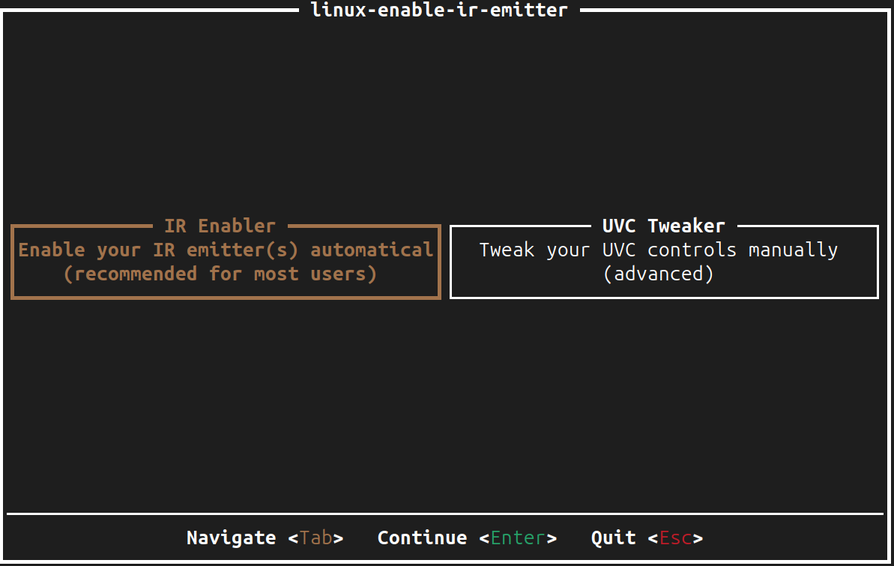
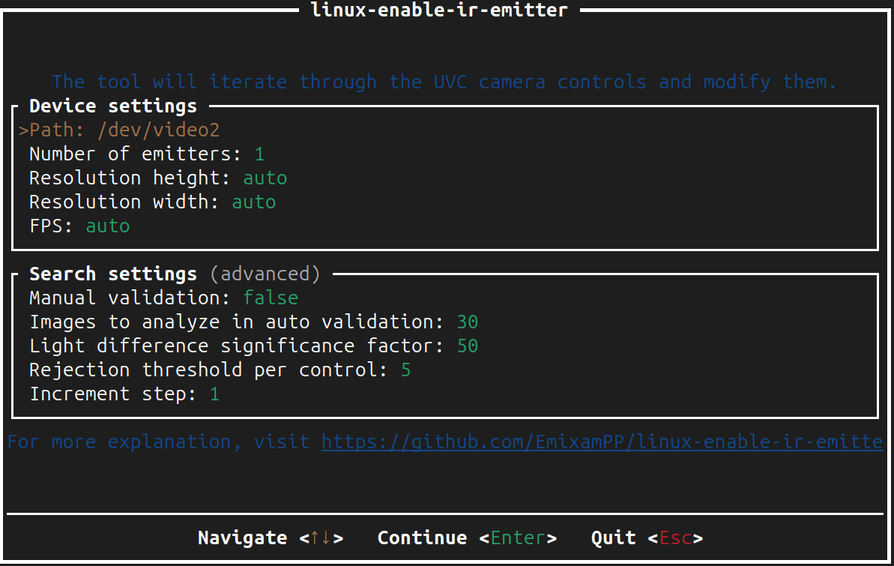
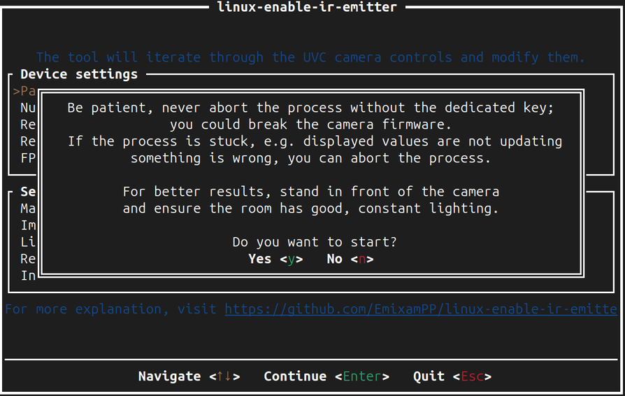
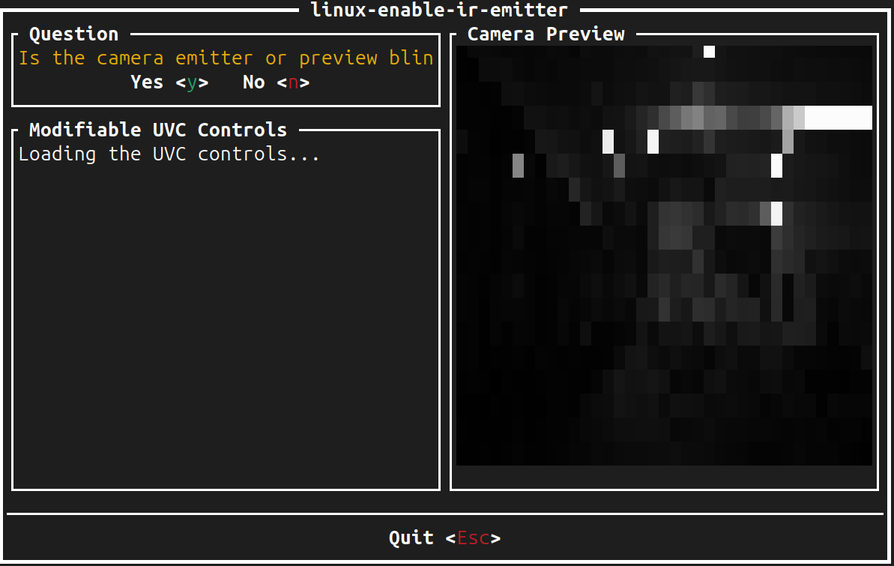
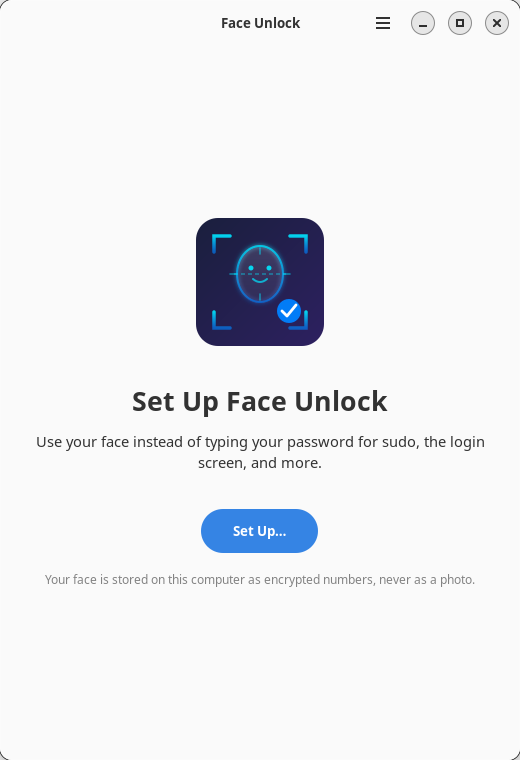
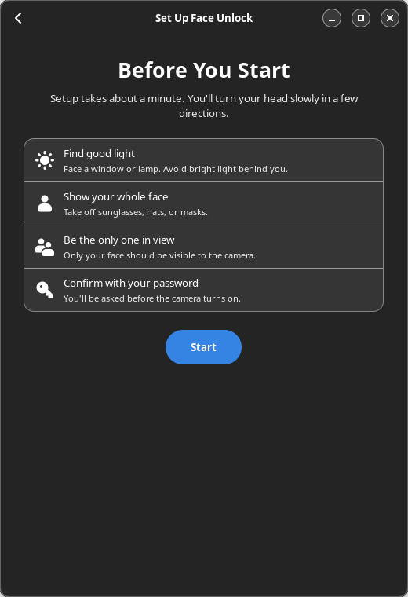
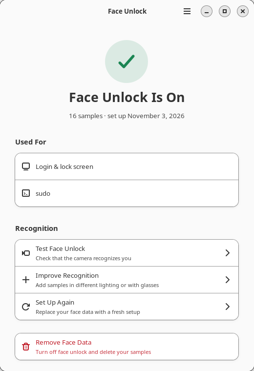
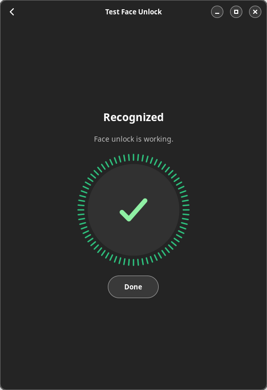

# Installing FaceAuth, step by step

This guide walks through the whole setup with pictures: installing, switching
on an infrared camera's light, setting up your face and trying it. It takes
about 10 minutes. Your password always keeps working, whatever happens.

**Contents**

1. [Run the installer](#1-run-the-installer)
2. [Answer its questions](#2-answer-its-questions)
3. [Switch on the infrared light](#3-switch-on-the-infrared-light-infrared-cameras-only) (infrared cameras only)
4. [Set up your face](#4-set-up-your-face)
5. [Try it](#5-try-it)
6. [Running the installer again](#6-running-the-installer-again)
7. [If something goes wrong](#7-if-something-goes-wrong)
8. [Uninstall](#8-uninstall)

---

## 1. Run the installer

Open a terminal **as your normal user** (not `sudo -i` or a root shell) and run:

```bash
curl -fsSL https://raw.githubusercontent.com/ibrahimgulbutt/faceauth/main/install.sh | bash
```

Or, from a copy of the code:

```bash
git clone https://github.com/ibrahimgulbutt/faceauth.git
cd faceauth
./install.sh
```

That's the only command you need. The installer downloads everything itself
(build tools, the face models and, if needed, the infrared light helper) and
checks every download against a known checksum. Building takes a few minutes
the first time.

It asks for your password once, so it can install system files.

---

## 2. Answer its questions

Press **Enter** to accept the suggested answer, shown in `[brackets]`.

**Face recognizer**

```
Which face recognizer should FaceAuth use?
  1) Accurate  ResNet50, much better at telling similar faces apart (~300 MB download) [recommended]
  2) Fast      MobileFaceNet, smaller and quicker (~15 MB download)
Choose [1]:
```

Press **Enter** for Accurate.

**Camera** (only on computers with an infrared camera, such as laptops made
for Windows Hello)

```
This computer has an infrared camera (Integrated IR Camera). Which camera should FaceAuth use?
  1) Infrared camera  works in the dark, harder to fool [recommended]
     (if its light is off, the installer helps you switch it on)
  2) Normal camera    works right away, needs some light
Choose [1]:
```

Press **Enter** for the infrared camera. If you'd rather skip the light setup
in step 3, choose **2**. You can switch later by running the installer again.

**Where to use face unlock**

The installer lists the places it can add face unlock: `sudo`, the login
screen, the lock screen, and admin password prompts. Choose the ones you want.
`sudo` alone is a good start.

---

## 3. Switch on the infrared light (infrared cameras only)

An infrared camera sees with its own invisible infrared light, the
**emitter**, next to the lens. On Windows a vendor driver switches it on. Linux
doesn't know that vendor command, so on many laptops the light stays off and
the infrared picture is almost black, **even in a bright room**: normal room
lights give off almost no infrared.

The installer checks this for you:

```
==> Checking the infrared light
    Look at the camera, then press Enter:
```

Look at the camera and press **Enter**. If the light already works, you'll see
`✓ The infrared light works` and can skip to [step 4](#4-set-up-your-face).

If it's off, the installer downloads a small open-source helper,
[linux-enable-ir-emitter](https://github.com/EmixamPP/linux-enable-ir-emitter),
which finds the right command by trying the camera's settings one by one while
it watches the picture. The installer prints the steps, then waits for
**Enter** before opening the helper.

### 3.1 Choose "IR Enabler"



**IR Enabler** is already selected (orange). Press **Enter**.
(UVC Tweaker is a manual mode for experts. You don't need it.)

### 3.2 Keep the settings



Don't change anything. **Path** is your infrared camera, and *Manual validation:
false* means the helper judges the picture itself. Press **Enter**.

### 3.3 Start



Read the note, then press **Y**. From now on:

- sit in front of the camera, fairly close, and keep still;
- keep the lighting the same (don't switch lights on or off);
- **don't close the window or press Ctrl+C**. To give up, press **Esc**.

### 3.4 Answer its questions



When the helper isn't sure, it asks **"Is the camera emitter or preview
blinking?"**

> **The first time it asks, it hasn't changed anything yet. Press N.**
> The dark, blocky preview above is what "off" looks like.

After that, it tries settings and may ask again:

- press **Y** only if the preview suddenly gets brighter or flickers, or you
  see a flashing light next to the lens. A phone camera pointed at the laptop
  shows the infrared light as a purple-white flicker;
- otherwise press **N**.

It can take a few minutes and closes by itself when it's done.

### 3.5 What happens next

The installer reads what the helper found, saves it in FaceAuth's settings
and checks the light again:

```
    Checking the light. Look at the camera, then press Enter:
    ✓ The infrared light works now (face brightness 112)
```

FaceAuth now switches the light on itself every time it uses the camera. The
helper doesn't need to run again.

If no setting was found, the installer offers to try again. If you say no,
or the second try also fails, **it switches to the normal camera** so face
unlock still works:

```
    ✓ Using the colour camera. Re-run this installer any time to try the IR camera again.
```

Pressed the wrong key? Just run the installer again and choose the infrared
camera.

---

## 4. Set up your face

Open **Face Unlock** from your app menu (or run `faceauth enroll` in a
terminal).



Choose **Set Up**. It asks for your password, so nobody else can add their
face to your account.



Then follow the prompts: look straight at the camera, then slowly turn your
head left, right, up and down. The ring fills as good pictures are collected.
Only your face should be in view.



**Already set up before, or changed camera?** If the app says face unlock is
**paused**, choose **Set Up Again**. Face data from another camera or an
older version can't be reused, so it isn't.

---

## 5. Try it



**On GNOME** (Ubuntu's normal desktop), **log out and back in once** after
installing. From then on a small face shows while FaceAuth checks you. It
looks for you, smiles when it recognizes you, and looks sad when it doesn't:

| Lock screen | `sudo` and admin prompts |
|---|---|
|  |  |

(These pictures come from a plain test setup. You'll see your own wallpaper.)

Use **Test** in the app, or in a terminal:

```bash
sudo -k && sudo echo "Hello from FaceAuth"
```

You'll see `FaceAuth: look at the camera…` and, about a second later, the
command runs without asking for your password. If you're not recognized, it
simply asks for your password as usual.

---

## 6. Running the installer again

Running the installer again is safe, and it says what it's going to do first:

| You have | It says |
|---|---|
| Nothing installed | `Installing FaceAuth 1.0.0` |
| The same version | `FaceAuth 1.0.0 is already installed. Reinstalling it to repair anything missing.` |
| An older version | `FaceAuth 1.0.0 is installed. Upgrading to 1.1.0` |
| A newer version | asks before installing the older one |

Your settings and face data are kept, and your current choices are offered
as the defaults. Run it again to repair a broken install, upgrade, switch
camera, or retry the infrared light.

---

## 7. If something goes wrong

Start with:

```bash
faceauth doctor
```

It checks the service, camera, models, infrared light, PAM and polkit, and
tells you what to fix.

| Problem | What to do |
|---|---|
| `sudo: ./install.sh: command not found` | You're not in the FaceAuth folder. `cd` into it first. |
| `Run this as your regular user, not root` | You're in a root shell (`root@…#`). Type `exit`, then run the installer again. |
| The infrared picture is black in a bright room | Normal: room lights give off almost no infrared. The camera's own light has to be on; see [step 3](#3-switch-on-the-infrared-light-infrared-cameras-only). |
| "the IR emitter is already working" but it isn't | **Y** was pressed at the helper's first question. Run the installer again and press **N** the first time. |
| Not sure the infrared light works | `faceauth benchmark` while looking at the camera: face brightness above 40 means it's on. |
| The app says face unlock is **paused** | The camera or face model changed. Choose **Set Up Again**. |
| No password dialog when setting up | Run `faceauth enroll` in a terminal instead. |
| Not recognized in the dark with the normal camera | A normal camera can't see in the dark. Use the infrared camera. |

Still stuck? [Open an issue](https://github.com/ibrahimgulbutt/faceauth/issues)
with the output of `faceauth doctor`.

---

## 8. Uninstall

```bash
/usr/local/share/faceauth/uninstall.sh
```

It removes FaceAuth from every PAM file (with backups), the service, the files
and, if you agree, your face data. The infrared helper, if installed, stays in
`/usr/local/bin/linux-enable-ir-emitter`. Remove it with
`sudo rm /usr/local/bin/linux-enable-ir-emitter` if you like.
